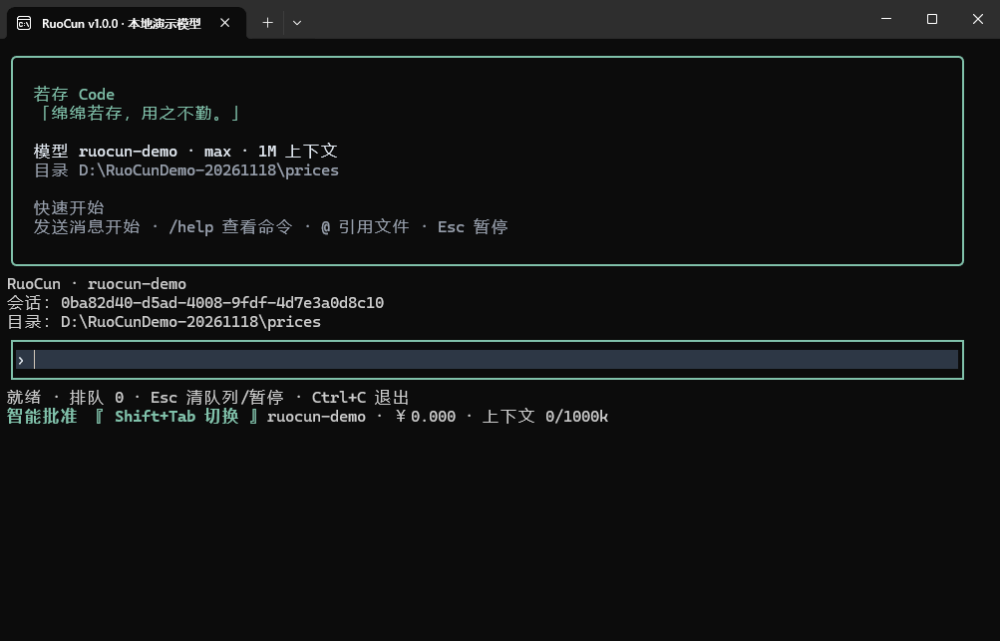
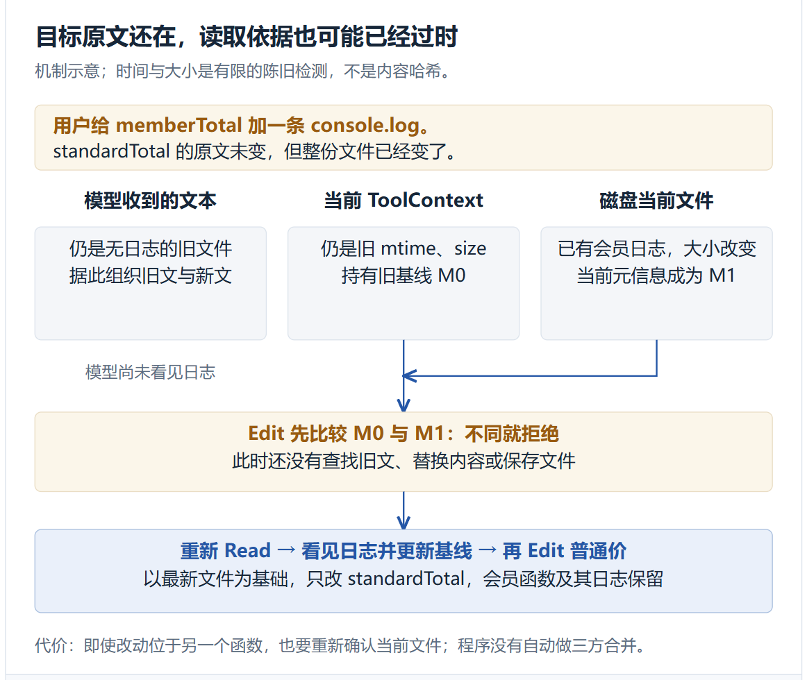
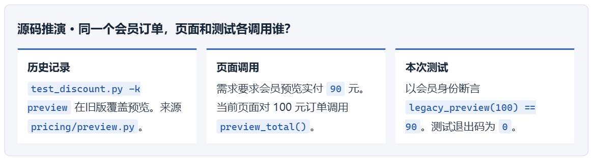
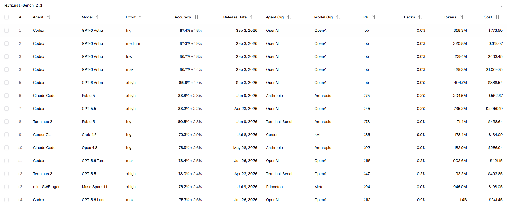

# 若存 RuoCun｜Coding Agent 工程参考实现

若存是一套可运行的终端编码智能体，为已经接触过 Agent 或 Harness、想读懂一套完整工程的开发者而做。

配套的 22 章中文源码课程沿着一次编码任务展开。从模型如何接收任务、工具如何执行，到上下文如何管理、会话中断后如何恢复，每章都从具体工程问题出发，回到源码讲清设计取舍。你可以先跑通一个任务，再动手改动其中一环，用任务结果检验自己的判断。

[开始读课](https://hmmgotit.github.io/RuoCun/learning/课程学习地图.html) · [打开项目主页](https://hmmgotit.github.io/RuoCun/) · [查看 89 题成绩](docs/benchmark/README.md) · [下载 v1.0.0](https://github.com/hmmgotit/RuoCun/releases/tag/v1.0.0)



*折扣案例 · Windows Terminal 实录 · 本地模拟模型响应*

## 课程示例

三篇都沿用同一个订单案例。点图可以打开对应讲解，再顺着课件里的行号跳到源码。

### 第 06 章 · 文件编辑

同事给会员函数加了一行日志。即使普通价函数的原文还能唯一匹配，这次 `Edit` 为什么要先停下来？

<a href="https://hmmgotit.github.io/RuoCun/learning/01-文件编辑可靠性-精致教材预览.html#stale-observation"></a>

### 第 15 章 · 摘要丢了细节怎样回查

做了两次压缩以后，如何沿着旧摘要找回会员订单的测试回执？

<a href="https://hmmgotit.github.io/RuoCun/learning/15-摘要丢了细节怎样回查.html#summary-lineage-paths"></a>

### 第 17 章 · 经验怎样用到当前任务

照着上次的经验跑测试，退出码是 0。怎样确认测试走的就是会员页面正在用的代码？

<a href="https://hmmgotit.github.io/RuoCun/learning/17-经验怎样用到当前任务.html#memory-case"></a>

## 五题缓存对照

**五道同题实测，若存输入缓存命中率 99.34%，DeepSeek Harness 为 99.07%。**

| Terminal-Bench 2.1 任务 | 若存 | DeepSeek Harness |
| --- | ---: | ---: |
| `cobol-modernization` | 99.57% | 99.20% |
| `db-wal-recovery` | 98.71% | 95.70% |
| `multi-source-data-merger` | 98.44% | 97.04% |
| `adaptive-rejection-sampler` | 99.18% | 99.17% |
| `bn-fit-modify` | 98.54% | 96.32% |
| **按输入 Token 加权** | **99.34%** | **99.07%** |

每个框架每题各跑一次。若存通过 5 题，DeepSeek Harness 通过 4 题。已确认用量按低峰价折算，分别约为 ¥1.66 和 ¥1.82。命中率按命中的输入 Token 占比计算，费用还取决于未命中的输入和输出量。[实验口径与用量表](docs/benchmark/README.md#五道同题的缓存命中)

前缀缓存会复用已经处理过的输入。若存把每轮可能变化的目录快照放在请求尾部，让前面的内容更容易复用。[第 16 章 · 前缀缓存怎样配合请求](https://hmmgotit.github.io/RuoCun/learning/16-前缀缓存怎样配合请求.html)

## Terminal-Bench 2.1

**在 Terminal-Bench 2.1 项目自测中，若存通过 71 / 89 项任务（79.78%）。与官方榜的 Codex + GPT‑6 Astra（xhigh，85.8%）相差约 6 个百分点，按 89 题折算约 5 题。**

Terminal-Bench 2.1 是第三方基准，通过 Harbor 在独立容器中评测 Agent，任务覆盖系统管理、安全、数据科学、科学计算、调试和机器学习等领域。89 道题的最终成绩、判分来源和可公开的用量数据均可查阅。[Harbor](https://www.harborframework.com/) · [评测报告](docs/benchmark/README.md) · [逐题 CSV](docs/benchmark/results.csv) · [精简 XLSX](docs/benchmark/terminal-bench-2.1.xlsx)

若存 89 题的已确认模型用量按低峰价估算为 ¥31.07，按高峰价估算为 ¥62.15。榜单原图中，该 Codex 条目显示 $888.54。若存成绩来自两件历史测评制品的逐题有效记录，官方榜单按多次试验统计。[成本与评测口径](docs/benchmark/README.md#与官方榜单对照) · [Harbor 官方榜单](https://hub.harborframework.com/datasets/terminal-bench/terminal-bench-2-1/latest?leaderboard=main&tab=leaderboard)

<details>
<summary>查看 Terminal-Bench 2.1 历史榜单原图</summary>



</details>

## 上下文与记忆

**长任务中的原文还能查。** 上下文接近预算时，若存先裁剪特别长的工具输出。需要继续释放空间时，再总结较早的对话，保留近期原文和完整的工具调用关系。压缩参考 DeepSeek Harness 的设计，会话原文归档在 SQLite，需要细节时可以用 `ArchiveRead` 回查。[上下文管理](docs/context-management.md)

**以前修过的坑，下次还能派上用场。** 例如修过「空页仍有下一页游标」的分页问题，可以把触发条件、处理方法和验证证据写进记忆。遇到相关任务时，若存把候选经验带进当前请求，模型可以核对当前代码，再决定是否沿用。[记忆系统](docs/memory-design.md)

## 快速开始

当前发布包面向 **Windows x64 / CPython 3.11**。从 [v1.0.0 Release](https://github.com/hmmgotit/RuoCun/releases/tag/v1.0.0) 下载 wheel，在文件所在目录打开 PowerShell，安装到独立环境。

```powershell
py -3.11 -m venv .venv
.\.venv\Scripts\python.exe -m pip install .\ruocun-1.0.0-py311-none-win_amd64.whl
.\.venv\Scripts\python.exe -m ruocun --cwd "C:\path\to\project"
```

第一次启动时，终端引导会设置模型服务、API 密钥和工作目录信任。可以从很小的改动开始，例如让若存读一份模块、修正一处逻辑，再运行对应测试。任务跑完后，从[第 1 章](https://hmmgotit.github.io/RuoCun/learning/01-一次任务怎样跑完.html)追一遍这条链路。

[安装、更新与恢复](docs/install-and-recovery.md) · [从源码构建](docs/development.md)

## 许可证

若存原创内容采用 MIT 许可证。第三方材料的来源与许可见附带声明。[MIT](LICENSE) · [来源说明](NOTICE.md) · [第三方许可证](THIRD-PARTY-LICENSES.txt)
