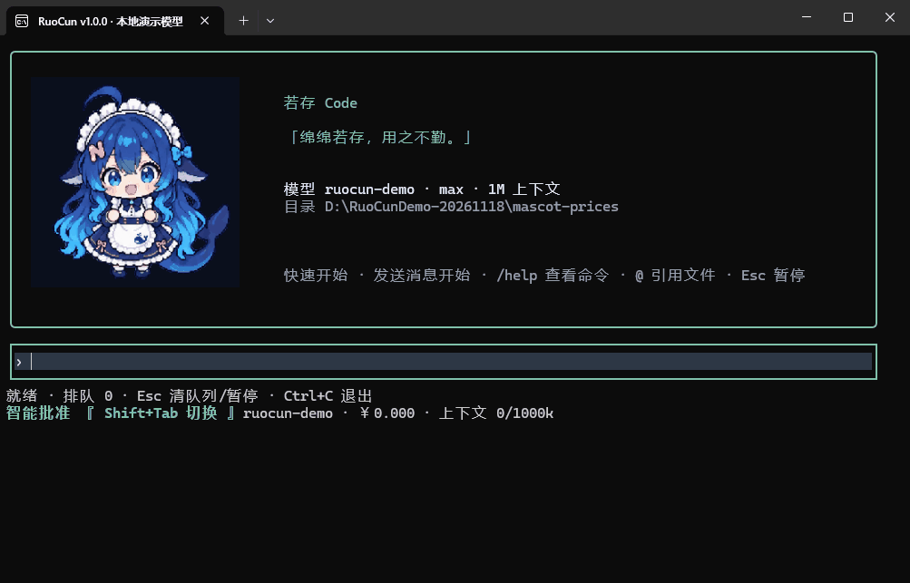
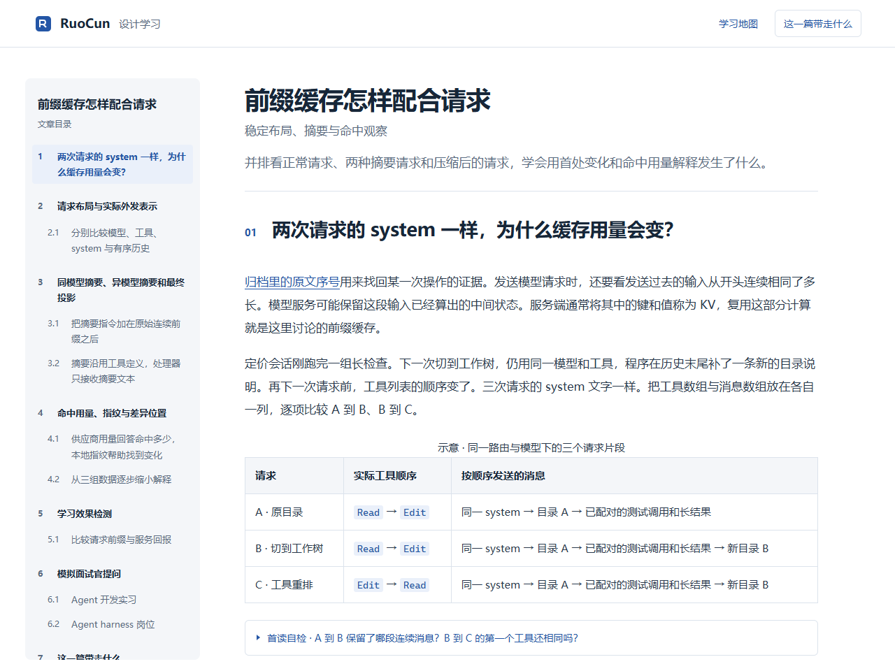
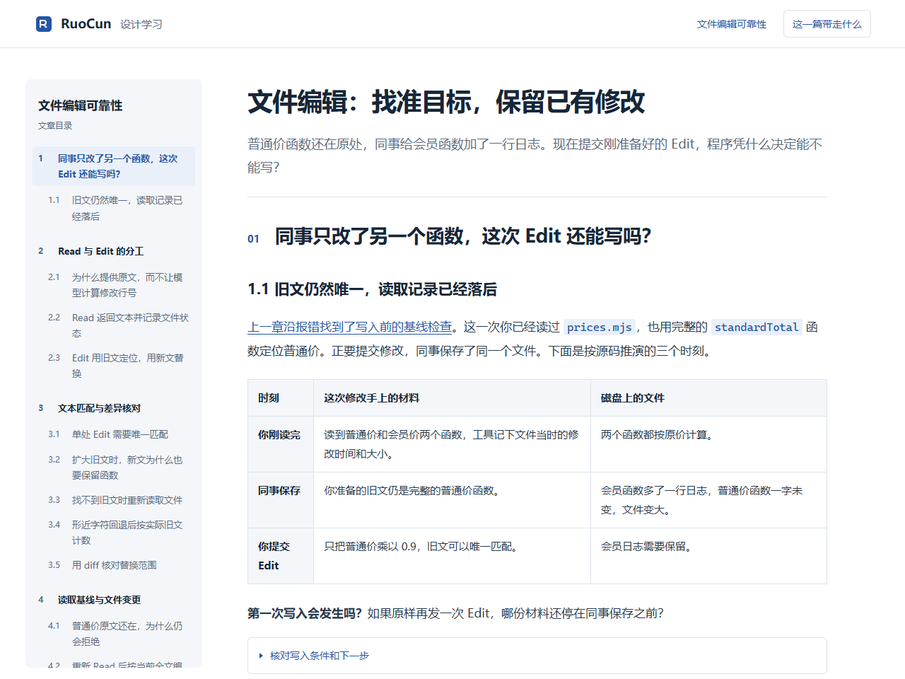
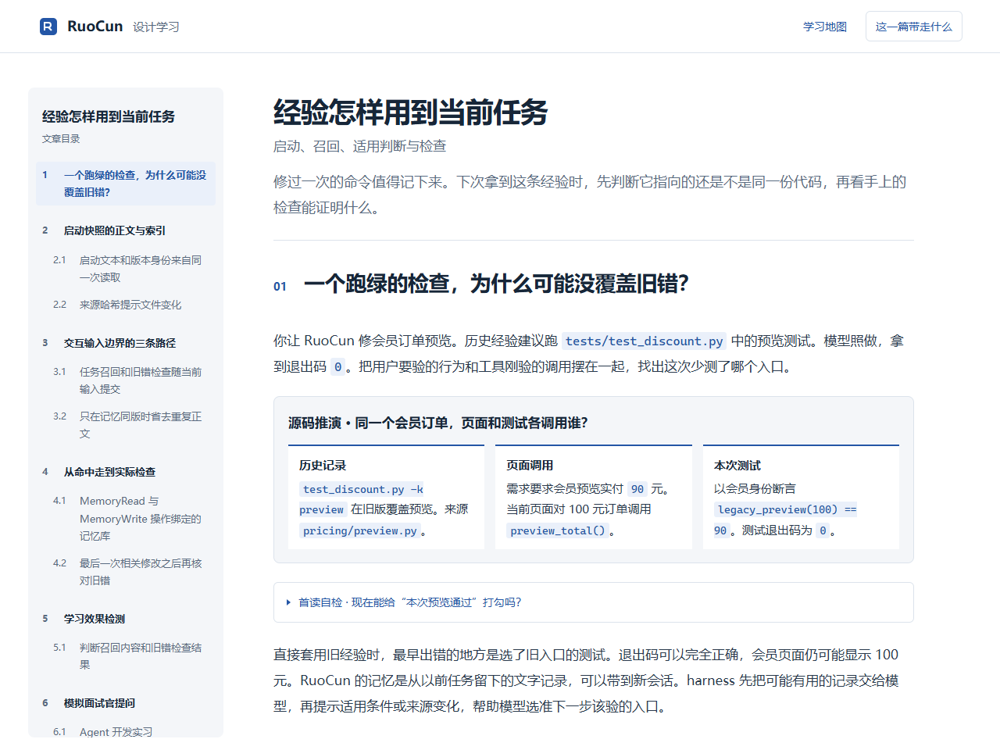
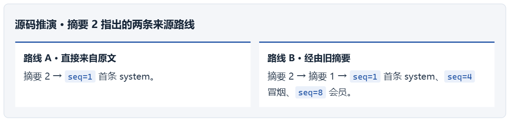

# 若存 RuoCun｜Coding Agent 工程参考实现

若存是一套可运行的终端编码智能体，为已经接触过 Agent 或 Harness、想读懂一套完整工程的开发者而做。

配套的 22 章中文源码课程沿着一次编码任务展开。从模型如何接收任务、工具如何执行，到上下文如何管理、会话中断后如何恢复，每章都从具体工程问题出发，回到源码讲清设计取舍。你可以先跑通一个任务，再动手改动其中一环，用任务结果检验自己的判断。

[开始读课](https://hmmgotit.github.io/RuoCun/learning/课程学习地图.html) · [打开项目主页](https://hmmgotit.github.io/RuoCun/) · [查看 89 题成绩](docs/benchmark/README.md) · [下载 v1.0.0](https://github.com/hmmgotit/RuoCun/releases/tag/v1.0.0)



*折扣案例 · Windows Terminal 实录 · 本地模拟模型响应*

## 课程示例

点开预览图，就能看到对应的课件原页，再顺着正文里的行号读源码。

### 第 16 章 · 前缀缓存怎样配合请求

两次请求的 system 一样，为什么缓存命中用量还会变？左侧目录列出了整篇的阅读路线。正文把原目录、切到工作树和工具重排三种请求放在同一张 A／B／C 对照表里，逐项比较工具顺序和请求前缀。

<a href="https://hmmgotit.github.io/RuoCun/learning/16-前缀缓存怎样配合请求.html"></a>

从具体问题出发，依次读请求布局、摘要与最终投影，再用命中用量验证判断。最后还有练习和模拟面试题。 [直达 A／B／C 请求表](https://hmmgotit.github.io/RuoCun/learning/16-前缀缓存怎样配合请求.html#prefix-request-diff)

<details>
<summary>第 06 章 · 文件编辑怎样保留同事的修改</summary>

同事给会员函数加了一行日志。即使普通价函数的原文还能唯一匹配，这次 `Edit` 为什么要先停下来？

<a href="https://hmmgotit.github.io/RuoCun/learning/01-文件编辑可靠性-精致教材预览.html"></a>

</details>

<details>
<summary>第 17 章 · 经验怎样用到当前任务</summary>

照着上次的经验跑测试，退出码是 0。怎样确认测试走的就是会员页面正在用的代码？

<a href="https://hmmgotit.github.io/RuoCun/learning/17-经验怎样用到当前任务.html"></a>

</details>

<details>
<summary>展开文件编辑、摘要回查与经验验证的课件图解</summary>

**第 06 章** · 下一次编辑时，磁盘上的文件跟刚才读取的一样吗？

<a href="https://hmmgotit.github.io/RuoCun/learning/01-文件编辑可靠性-精致教材预览.html#stale-observation"></a>

**第 15 章** · 做了两次压缩以后，如何沿着旧摘要找回会员订单的测试回执？

<a href="https://hmmgotit.github.io/RuoCun/learning/15-摘要丢了细节怎样回查.html#summary-lineage-paths"></a>

**第 17 章** · 上次的回归用例在当前任务里还测得到正确入口吗？

<a href="https://hmmgotit.github.io/RuoCun/learning/17-经验怎样用到当前任务.html#memory-case"></a>

</details>

## 五题缓存对照

**五道同题实测，若存输入缓存命中率 99.34%，DeepSeek Harness 为 99.07%。**

| Terminal-Bench 2.1 任务 | 若存 | DeepSeek Harness |
| --- | ---: | ---: |
| `cobol-modernization` | 99.57% | 99.20% |
| `db-wal-recovery` | 98.71% | 95.70% |
| `multi-source-data-merger` | 98.44% | 97.04% |
| `adaptive-rejection-sampler` | 99.18% | 99.17% |
| `bn-fit-modify` | 98.54% | 96.32% |
| **按输入 Token 加权** | **99.34%** | **99.07%** |

每个框架每题各跑一次。若存通过 5 题，DeepSeek Harness 通过 4 题。已确认用量按低峰价折算，分别约为 ¥1.66 和 ¥1.82。命中率按命中的输入 Token 占比计算，费用还取决于未命中的输入和输出量。[实验口径与用量表](docs/benchmark/README.md#五道同题的缓存命中)

前缀缓存会复用已经处理过的输入。若存把每轮可能变化的目录快照放在请求尾部，让前面的内容更容易复用。[第 16 章 · 前缀缓存怎样配合请求](https://hmmgotit.github.io/RuoCun/learning/16-前缀缓存怎样配合请求.html)

## Terminal-Bench 2.1

**在 Terminal-Bench 2.1 项目自测中，若存通过 71 / 89 项任务（79.78%）。与官方榜的 Codex + GPT‑6 Astra（xhigh，85.8%）相差约 6 个百分点，按 89 题折算约 5 题。**

Terminal-Bench 2.1 是第三方基准，通过 Harbor 在独立容器中评测 Agent，任务覆盖系统管理、安全、数据科学、科学计算、调试和机器学习等领域。89 道题的最终成绩、判分来源和可公开的用量数据均可查阅。[Harbor](https://www.harborframework.com/) · [评测报告](docs/benchmark/README.md) · [逐题 CSV](docs/benchmark/results.csv) · [精简 XLSX](docs/benchmark/terminal-bench-2.1.xlsx)

若存 89 题的已确认模型用量按 DeepSeek 低峰价估算为 **¥31.07**，按高峰价估算为 **¥62.15**，分别约为 **Codex + GPT‑6 Astra（xhigh）榜单总费用的 0.52% 和 1.04%**。榜单的 **$888.54** 按 2026 年 11 月 18 日中间价（1 美元兑 6.7118 元）折合 **¥5,963.70**。

若存按历史测评每题一个选定的有效结果汇总，其中 5 次请求缺少模型用量。官方榜单汇总多次试验，两边使用的模型和试次数有差异。 [成本与评测口径](docs/benchmark/README.md#与官方榜单对照) · [Harbor 官方榜单](https://hub.harborframework.com/datasets/terminal-bench/terminal-bench-2-1/latest?leaderboard=main&tab=leaderboard) · [人民币汇率中间价](https://www.chinamoney.com.cn/chinese/bkccpr/index.html?tab=2)

<details>
<summary>查看 Terminal-Bench 2.1 历史榜单原图</summary>


</details>

## 上下文与记忆

### 压缩之后，原始测试回执还能找回来吗？

调试跑了几十轮，构建和测试日志把上下文挤满了。若存会把消息、工具定义和输出余量一起纳入预算，先裁剪特别长的工具输出，仍超预算才摘要较早的对话。生成摘要时保留近期消息，工具调用和对应结果按组处理。

新视图和原文索引一起写入 SQLite，确认保存后才切换。想核对「会员价测试失败」的细节，可按归档 ID 用 `ArchiveRead` 回查原始测试输出。压缩失败时保留原视图。压缩策略参考 DeepSeek Harness 的 `compaction-basic`。 [上下文设计](docs/context-management.md)

### 以前修过的坑，换个任务还能用吗？

比如上次分页遇到空页时提前退出了。可以把经验记成「空页仍有下一页游标时，继续翻页」，并附上空页后成功读到下一页的测试证据。遇到相似任务，先核对当前接口是否仍遵循这个规则，再跑相应用例确认。

普通 CLI 默认加载启动记忆快照，`--memory-strategy task` 可为新任务补充相关经验。自动学习默认关闭，显式启用 `--memory-learning controlled` 后，若存可从项目里的纠错和验证结果提炼新经验。 [记忆设计](docs/memory-design.md)

## 快速开始

当前发布包面向 **Windows x64 / CPython 3.11**。从 [v1.0.0 Release](https://github.com/hmmgotit/RuoCun/releases/tag/v1.0.0) 下载 wheel，在文件所在目录打开 PowerShell，安装到独立环境。

```powershell
py -3.11 -m venv .venv
.\.venv\Scripts\python.exe -m pip install .\ruocun-1.0.0-py311-none-win_amd64.whl
.\.venv\Scripts\python.exe -m ruocun --cwd "C:\path\to\project"
```

第一次启动时，终端引导会设置模型服务、API 密钥和工作目录信任。可以从很小的改动开始，例如让若存读一份模块、修正一处逻辑，再运行对应测试。任务跑完后，从[第 1 章](https://hmmgotit.github.io/RuoCun/learning/01-一次任务怎样跑完.html)追一遍这条链路。

[安装、更新与恢复](docs/install-and-recovery.md) · [从源码构建](docs/development.md)

## 许可证

若存原创内容采用 MIT 许可证。第三方材料的来源与许可见附带声明。[若存开源许可](LICENSE) · [来源说明](NOTICE.md) · [第三方许可证](THIRD-PARTY-LICENSES.txt)
