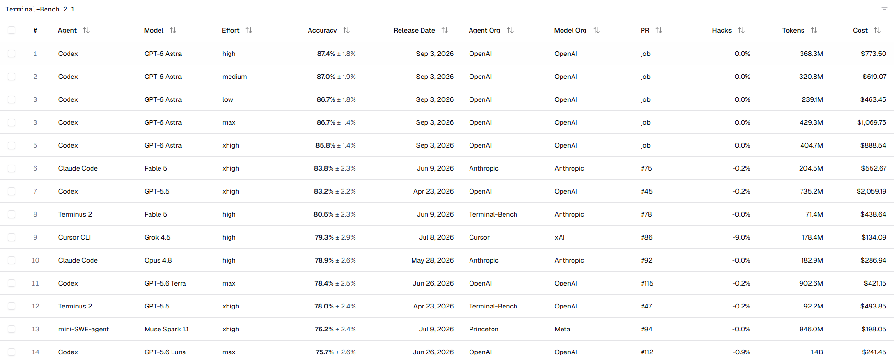

# Terminal-Bench 2.1 测评记录

在 Terminal-Bench 2.1 项目自测中，若存通过 **71 / 89** 项任务（**79.78%**）。89 道题均有有效成绩，每题保留一个最终有效结果，其中 18 题得 0 分。

[下载精简版 Excel](terminal-bench-2.1.xlsx) · [逐题 CSV](results.csv) · [逐题 JSON](results.json)

## 怎么读这次测评

使用 Harbor 运行 Terminal-Bench 2.1。任务涉及系统管理、软件调试、数据科学、科学计算、机器学习和安全等领域。归档中 87 题来自 2026 年 11 月 15 日的桌面测评版本，另 2 题来自历史 v0.9.0。成绩包含对原提交的有效补判，以及 fastText 在修正桥接后的较晚有效复测。 [Harbor](https://www.harborframework.com/) · [Terminal-Bench 2.1](https://github.com/harbor-framework/terminal-bench-2-1)

## 与官方榜单对照

Codex + GPT‑6 Astra（xhigh）的官方榜单成绩为 **85.8% ± 1.4%**，高出若存项目自测约 **6.02 个百分点**，按 89 题折算约 **5 题**。榜单要求每题至少 5 次试验，表中 `Cost` 对应榜单条目自己的试验。 [Harbor 官方榜单](https://hub.harborframework.com/datasets/terminal-bench/terminal-bench-2-1/latest?leaderboard=main&tab=leaderboard) · [提交规则](https://github.com/harbor-framework/terminal-bench-2-1/blob/main/README.md#submitting-to-the-leaderboard)

| 系统 | 成绩 | 模型费用 |
| --- | ---: | --- |
| 若存项目自测 | 71 / 89（79.78%） | 已确认用量折算 ¥31.07（低峰）、¥62.15（高峰） |
| Codex + GPT‑6 Astra（xhigh） | 85.8% ± 1.4% | 官方榜单 $888.54 |
| Codex + GPT‑6 Astra（high） | 87.4% ± 1.8% | 官方榜单 $773.50 |
| Claude Code + Fable 5（xhigh） | 83.8% ± 2.3% | 官方榜单 $552.67 |
| Terminus 2 + Fable 5（high） | 80.5% ± 2.3% | 官方榜单 $438.64 |

若存记录了 4,927 次 API 请求，其中 4,922 次有确认用量。上表按已确认的模型 token 和 DeepSeek 公布单价估算。两个结果使用不同模型、试次数和币种。 [DeepSeek 计价](https://api-docs.deepseek.com/zh-cn/quick_start/pricing/)

## 五道同题的缓存命中

五道同题实测，**若存输入缓存命中率 99.34%，DeepSeek Harness 为 99.07%**。公式为 `命中的输入 token ÷ 总输入 token`，汇总时先分别加总分子和分母。

| 题目 | 若存命中率 | DeepSeek Harness 命中率 | 若存得分 | DeepSeek Harness 得分 |
| --- | ---: | ---: | ---: | ---: |
| `cobol-modernization` | 99.57% | 99.20% | 1 | 1 |
| `db-wal-recovery` | 98.71% | 95.70% | 1 | 1 |
| `multi-source-data-merger` | 98.44% | 97.04% | 1 | 1 |
| `adaptive-rejection-sampler` | 99.18% | 99.17% | 1 | 0 |
| `bn-fit-modify` | 98.54% | 96.32% | 1 | 1 |

前 3 题来自 2026 年 11 月 15 日候选版扩测，后 2 题来自 v0.9.0。两边同用 DeepSeek Flash 1017，各题各框架一次有效试次，原生协议和两批推理力度设置有差异，服务商缓存随请求自然累积。若存通过 5 题，DeepSeek Harness 通过 4 题。低峰模型费用估算分别为 ¥1.66 和 ¥1.82。

## 逐题成绩

`score` 是题目的最终得分，`passed` 和 `total` 是裁判通过的子项数和子项总数。裁判子项汇总缺失时留空。

| # | 题目 | 得分 | 裁判子项 |
| ---: | --- | ---: | ---: |
| 1 | `adaptive-rejection-sampler` | 1 | 9 / 9 |
| 2 | `bn-fit-modify` | 1 | 9 / 9 |
| 3 | `break-filter-js-from-html` | 1 | 1 / 1 |
| 4 | `build-cython-ext` | 1 | 11 / 11 |
| 5 | `build-pmars` | 1 | 4 / 4 |
| 6 | `build-pov-ray` | 1 | 3 / 3 |
| 7 | `caffe-cifar-10` | 1 | 6 / 6 |
| 8 | `cancel-async-tasks` | 1 | 6 / 6 |
| 9 | `chess-best-move` | 1 | 1 / 1 |
| 10 | `circuit-fibsqrt` | 1 | 3 / 3 |
| 11 | `cobol-modernization` | 1 | 3 / 3 |
| 12 | `code-from-image` | 1 | 2 / 2 |
| 13 | `compile-compcert` | 1 | 3 / 3 |
| 14 | `configure-git-webserver` | 1 | 1 / 1 |
| 15 | `constraints-scheduling` | 1 | 3 / 3 |
| 16 | `count-dataset-tokens` | 1 | 1 / 1 |
| 17 | `crack-7z-hash` | 0 | 0 / 2 |
| 18 | `custom-memory-heap-crash` | 1 | 6 / 6 |
| 19 | `db-wal-recovery` | 1 | 7 / 7 |
| 20 | `distribution-search` | 1 | 4 / 4 |
| 21 | `dna-assembly` | 1 | 1 / 1 |
| 22 | `dna-insert` | 1 | 1 / 1 |
| 23 | `extract-elf` | 1 | 2 / 2 |
| 24 | `extract-moves-from-video` | 0 | 0 / 2 |
| 25 | `feal-differential-cryptanalysis` | 1 | 1 / 1 |
| 26 | `feal-linear-cryptanalysis` | 1 | 1 / 1 |
| 27 | `filter-js-from-html` | 0 | 1 / 2 |
| 28 | `financial-document-processor` | 1 | 7 / 7 |
| 29 | `fix-code-vulnerability` | 1 | 6 / 6 |
| 30 | `fix-git` | 1 | 2 / 2 |
| 31 | `fix-ocaml-gc` | 1 | 1 / 1 |
| 32 | `gcode-to-text` | 0 | 1 / 2 |
| 33 | `git-leak-recovery` | 1 | 5 / 5 |
| 34 | `git-multibranch` | 1 | 1 / 1 |
| 35 | `gpt2-codegolf` | 0 | 0 / 1 |
| 36 | `headless-terminal` | 1 | 7 / 7 |
| 37 | `hf-model-inference` | 1 | 4 / 4 |
| 38 | `install-windows-3.11` | 1 | 4 / 4 |
| 39 | `kv-store-grpc` | 1 | 7 / 7 |
| 40 | `large-scale-text-editing` | 1 | 5 / 5 |
| 41 | `largest-eigenval` | 1 | 3 / 3 |
| 42 | `llm-inference-batching-scheduler` | 1 | 6 / 6 |
| 43 | `log-summary-date-ranges` | 1 | 2 / 2 |
| 44 | `mailman` | 1 | 3 / 3 |
| 45 | `make-doom-for-mips` | 0 | 0 / 3 |
| 46 | `make-mips-interpreter` | 1 | 3 / 3 |
| 47 | `mcmc-sampling-stan` | 0 | 5 / 6 |
| 48 | `merge-diff-arc-agi-task` | 1 | 5 / 5 |
| 49 | `model-extraction-relu-logits` | 1 | 1 / 1 |
| 50 | `modernize-scientific-stack` | 1 | 2 / 2 |
| 51 | `mteb-leaderboard` | 1 | 2 / 2 |
| 52 | `mteb-retrieve` | 0 | 1 / 2 |
| 53 | `multi-source-data-merger` | 1 | 3 / 3 |
| 54 | `nginx-request-logging` | 1 | 8 / 8 |
| 55 | `openssl-selfsigned-cert` | 1 | 6 / 6 |
| 56 | `overfull-hbox` | 1 | 4 / 4 |
| 57 | `password-recovery` | 1 | 2 / 2 |
| 58 | `path-tracing` | 0 | 0 / 5 |
| 59 | `path-tracing-reverse` | 1 | 3 / 3 |
| 60 | `polyglot-c-py` | 1 | 1 / 1 |
| 61 | `polyglot-rust-c` | 1 | 1 / 1 |
| 62 | `portfolio-optimization` | 1 | 4 / 4 |
| 63 | `protein-assembly` | 0 | 0 / 1 |
| 64 | `prove-plus-comm` | 1 | 4 / 4 |
| 65 | `pypi-server` | 1 | 1 / 1 |
| 66 | `pytorch-model-cli` | 0 | 5 / 6 |
| 67 | `pytorch-model-recovery` | 1 | 5 / 5 |
| 68 | `qemu-alpine-ssh` | 1 | 1 / 1 |
| 69 | `qemu-startup` | 1 | 1 / 1 |
| 70 | `query-optimize` | 0 | 2 / 6 |
| 71 | `raman-fitting` | 0 | 1 / 3 |
| 72 | `regex-chess` | 1 | 4 / 4 |
| 73 | `regex-log` | 1 | 1 / 1 |
| 74 | `reshard-c4-data` | 1 | 1 / 1 |
| 75 | `rstan-to-pystan` | 1 | 6 / 6 |
| 76 | `sam-cell-seg` | 1 | 9 / 9 |
| 77 | `sanitize-git-repo` | 0 | 2 / 3 |
| 78 | `schemelike-metacircular-eval` | 1 | 1 / 1 |
| 79 | `sparql-university` | 1 | 3 / 3 |
| 80 | `sqlite-db-truncate` | 1 | 1 / 1 |
| 81 | `sqlite-with-gcov` | 1 | 3 / 3 |
| 82 | `torch-pipeline-parallelism` | 0 | 2 / 3 |
| 83 | `torch-tensor-parallelism` | 1 | 3 / 3 |
| 84 | `train-fasttext` | 0 | 0 / 2 |
| 85 | `tune-mjcf` | 1 | 4 / 4 |
| 86 | `video-processing` | 0 | 4 / 5 |
| 87 | `vulnerable-secret` | 1 | 3 / 3 |
| 88 | `winning-avg-corewars` | 0 | 1 / 3 |
| 89 | `write-compressor` | 1 | 3 / 3 |
